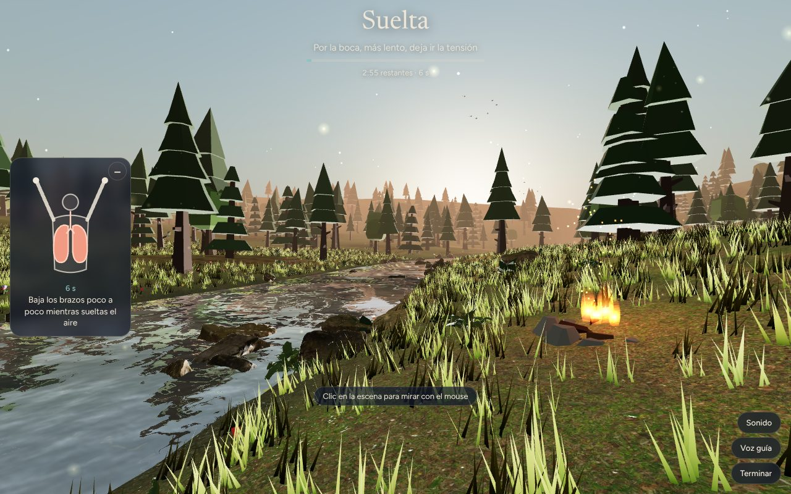
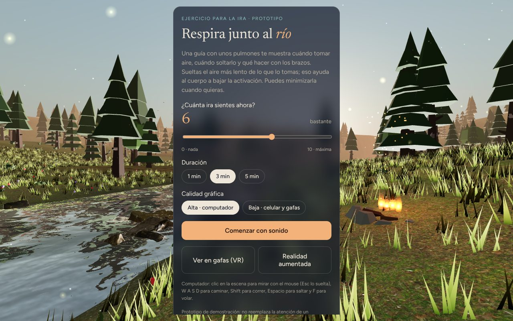
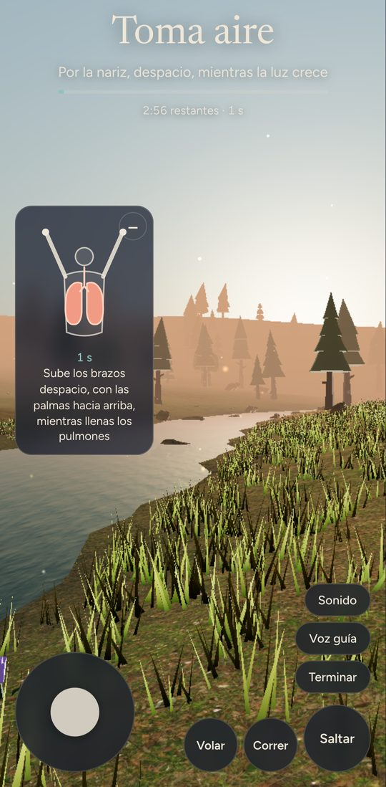

# Respira Lago

Ejercicio de respiración guiada en 3D para ayudar a manejar la **ira**. La persona entra a un bosque con un río a la hora dorada, con zorros, pájaros, peces, mariposas y una fogata. A un lado de la pantalla, una guía con unos pulmones le muestra cuándo tomar y soltar el aire y cómo mover los brazos; se puede minimizar. Hay sonido ambiente, voz guía en español y una escala de ira de 0 a 10 antes y después de cada sesión.

Es un **prototipo (MVP)** para mostrarle a un psicólogo y validar la idea. Funciona con un solo enlace en:

| Dispositivo | Cómo se controla |
|---|---|
| Computador | Clic en la escena para capturar el mouse y mirar (Esc lo suelta). **W A S D** caminar, **Shift** correr, **Espacio** saltar, **F** volar (en vuelo: Espacio sube, Ctrl o C baja) |
| Celular | Joystick a la izquierda para moverse, arrastrar el dedo en la pantalla para mirar y botones de **Saltar**, **Correr** y **Volar** |
| Gafas de realidad virtual (Meta Quest y otras con WebXR) | Botón **Ver en gafas (VR)**; se mira girando la cabeza, palanca izquierda para caminar despacio y derecha para girar por pasos. Sin correr ni volar, para no marear |
| Realidad aumentada (Chrome en Android, gafas con passthrough) | Botón **Realidad aumentada**; la guía de respiración flota en el cuarto real |

<p align="center">
  
</p>
<p align="center">
  
  &nbsp;
  
</p>

> **Aviso:** esto es una herramienta de apoyo, no un tratamiento. No reemplaza la atención de un profesional de salud mental. El contenido terapéutico (tiempos, frases) debe definirlo y validarlo el psicólogo a cargo.

---

## Cómo funciona una sesión

1. **Antes:** la persona marca cuánta ira siente (0 = nada, 10 = máxima) y elige la duración: 1, 3 o 5 minutos.
2. **Respiración:** cada ciclo es *toma aire (4 s) → sostén (1 s) → suelta (6 s) → descansa (1 s)*, unas 5 respiraciones por minuto. La guía, el sonido y la voz siguen el ritmo: los pulmones se llenan y se vacían, la figura sube los brazos al tomar aire y los baja al soltarlo, y una frase dice qué hacer con el cuerpo. La exhalación es más larga que la inhalación porque eso ayuda a bajar la activación del cuerpo.
3. **Después:** vuelve a marcar su nivel de ira y ve la diferencia, por ejemplo **6 → 3**.
4. **Historial:** se guardan las últimas sesiones (fecha, duración, antes y después) **solo en ese navegador**.

Al terminar puede repetir o quedarse paseando libremente por el bosque.

## Calidad gráfica

En la pantalla de inicio hay un selector **Alta / Baja**. La primera vez se elige solo: *baja* en celulares y gafas (Quest, Pico) y *alta* en computadores. La elección se guarda en el navegador y al cambiarla la escena se recarga. También se puede forzar con `?calidad=alta` o `?calidad=baja` al final de la dirección.

| | Alta | Baja |
|---|---|---|
| Árboles / helechos / manojos de pasto | 1100 / 240 / 36 000 | 380 / 90 / 7 000 |
| Flores / zorros / bandadas / peces / mariposas | 900 / 4 / 3 / 3 / 40 | 300 / 2 / 2 / 2 / 16 |
| Sombras suaves | Sí (2048 px) | No |
| Río | `Water` con reflejo en tiempo real | Agua liviana que refleja el cielo |
| Resolución | hasta 2× | hasta 1,25×; en VR 0,8× con *foveation* |

## Probarlo en tu computador

El sitio es estático (sin compilación). Solo hace falta [Node.js](https://nodejs.org) 20 o superior.

```bash
git clone https://github.com/Davidcasstella/respira-lago.git
cd respira-lago
npm install        # herramientas de desarrollo (una sola vez)
npm run dev        # abre http://localhost:8000
```

Sin Node también funciona: `python3 -m http.server 8000 -d frontend`. Si abres `frontend/index.html` con doble clic, el navegador bloquea los módulos y las texturas. Para un archivo que sí abre con doble clic: `npm run build:archivo` → `dist/respira-bosque.html`.

Para probar en el celular dentro de la misma red Wi‑Fi, abre `http://IP-DE-TU-PC:8000`. **VR y AR exigen https**, así que para las gafas usa la versión publicada (siguiente sección).

### Comandos

| Comando | Qué hace |
|---|---|
| `npm run dev` | Sirve `frontend/` en http://localhost:8000 |
| `npm run backend` | Arranca la API de ejemplo en http://localhost:3000 |
| `npm run verificar` | Lint + pruebas unitarias (frontend y backend) |
| `npm run test:navegador` | Prueba la app en Chromium, en escritorio y celular |
| `npm run build:archivo` | Genera un solo HTML con todo adentro |

## Publicarlo gratis

La carpeta que se publica es **`frontend/`**.

- **Vercel:** *Add New → Project* → elige este repo. `vercel.json` ya le dice que publique `frontend/` sin compilar. Cada push actualiza el sitio.
- **GitHub Pages:** en **Settings → Pages**, *Source*: **GitHub Actions**. Luego, en la pestaña **Actions**, ejecuta **"Publicar en GitHub Pages"**. Queda en `https://davidcasstella.github.io/respira-lago/`.

Los dos enlaces son https, así que en unas gafas Meta Quest basta con abrirlo en su navegador y tocar **Ver en gafas (VR)**.

## Estructura del proyecto

```
respira-lago/
├── frontend/                  Sitio web que se publica
│   ├── index.html             Pantallas de inicio, sesión y cierre
│   ├── css/estilos.css        Colores, tipografía y diseño
│   ├── js/
│   │   ├── protocolo.js       ← Contenido terapéutico (lo edita el psicólogo)
│   │   ├── app.js             Arranque: escena, pantallas, sesión, VR/AR y bucle
│   │   ├── config/            calidad.js: perfiles alta y baja
│   │   ├── escena/            terreno.js (relieve, río), bosque.js (plantas, rocas), vida.js (animales, fogata)
│   │   ├── controles/         controles.js: mouse, teclado, táctil y mandos VR
│   │   ├── audio/             sonido.js (ambiente) y voz.js (voz guía)
│   │   ├── sesion/            respiracion.js (ritmo) y guia.js (pulmones y brazos)
│   │   └── servicios/         historial.js: guarda las sesiones (hoy en el navegador)
│   └── assets/                Texturas, modelos .glb y CREDITOS.md
├── backend/                   API de ejemplo (Node, sin dependencias), aún sin datos reales
├── tests/                     Pruebas unitarias del frontend
├── scripts/                   Servidor local, prueba en navegador y empaquetado
├── docs/                      Documentación (protocolo, VR/AR, arquitectura, buenas prácticas)
└── .github/                   CI, plantillas de issues y PR, Dependabot
```

Cómo trabajar en el repo sin acumular deuda técnica: [CONTRIBUTING.md](CONTRIBUTING.md) y [docs/BUENAS-PRACTICAS.md](docs/BUENAS-PRACTICAS.md).

## Ajustar el ejercicio

Todo lo terapéutico está en un solo archivo, [`frontend/js/protocolo.js`](frontend/js/protocolo.js): segundos de cada fase, textos en pantalla, frases de la voz y palabras de la escala. Para cambiar el ritmo a 4‑7‑8, por ejemplo, se cambian tres números. La guía paso a paso está en [docs/PROTOCOLO.md](docs/PROTOCOLO.md).

## Tecnología

- **[Three.js](https://threejs.org/) r170** (`three@0.170.0`), cargado con *import map* desde jsdelivr: escena 3D y WebXR (VR/AR). De sus ejemplos oficiales se usan `Sky`, `Water`, `PointerLockControls` y `GLTFLoader`.
- **Recursos CC0** de [Poly Haven](https://polyhaven.com) y [Kenney](https://kenney.nl): texturas de 1K y modelos `.glb` pequeños (unos 2,4 MB en total). Detalle en [frontend/assets/CREDITOS.md](frontend/assets/CREDITOS.md).
- **Animales CC0** de [Quaternius](https://quaternius.com) (zorro, pájaro y pez con su animación), convertidos a `.glb`.
- **Web Audio API:** el río, los pájaros, la fogata y el acorde de fondo se sintetizan en el navegador, sin archivos de audio.
- **Web Speech API:** voz guía en español con la voz que tenga instalada el dispositivo.
- **localStorage:** historial local de sesiones.
- Sin frameworks ni compilación en el frontend. El backend es un esqueleto en Node sin dependencias (ver [backend/README.md](backend/README.md)).

Todo está en **escala real (metros)**: los ojos a 1,6 m de altura. Por eso la misma escena funciona en las gafas sin rehacerla. En VR se camina despacio (1,4 m/s), se gira por pasos y no se puede correr, saltar ni volar, para no causar mareo.

## Privacidad

- El prototipo **no envía datos a ningún servidor**. Las calificaciones de ira quedan en el `localStorage` del navegador de quien lo usa.
- Si en el futuro se guardan datos en la nube para que el psicólogo los vea, se necesita **consentimiento informado** y cumplir la ley de protección de datos (en Colombia, la Ley 1581 de 2012), porque son datos de salud, es decir, datos sensibles.

## Limitaciones conocidas

- La voz depende de las voces instaladas en el dispositivo; en algunos Android o computadores puede sonar en otro acento o no estar disponible.
- **iPhone/iPad:** Safari no soporta WebXR. Funciona en modo navegador (mirar y moverse con el dedo), pero sin VR ni AR.
- Apple Vision Pro tiene soporte WebXR limitado; hay que probarlo en el dispositivo.
- En VR los mandos solo sirven para moverse: la sesión arranca sola al entrar y la escala se responde fuera de las gafas.
- Los árboles son modelos *low-poly* (Kenney) con colores naturales, elegidos para que el bosque corra en celulares y en Quest. Se pueden cambiar por otros `.glb` en `frontend/js/escena/bosque.js`.
- En el computador, **Ctrl+W** cierra la pestaña en algunos navegadores: para bajar en vuelo también sirve **C**.
- El historial no se sincroniza entre dispositivos.

## Próximos pasos sugeridos

- [ ] Validar tiempos y frases con el psicólogo (en `frontend/js/protocolo.js`).
- [ ] Grabar una voz guía real (mp3) en lugar de la voz sintética.
- [ ] Usar el giroscopio del celular para mirar girando el teléfono.
- [ ] Usar los mandos o las manos en VR para elegir la duración y responder la escala dentro de las gafas.
- [ ] Más escenarios: playa, lluvia, nieve.
- [ ] Ejercicios para estrés, ansiedad y depresión, cada uno con su propio protocolo.
- [ ] Panel para el psicólogo con el historial de sus pacientes, con consentimiento y datos cifrados.
