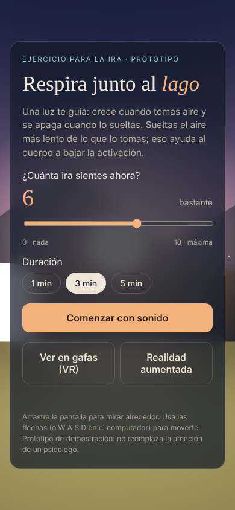
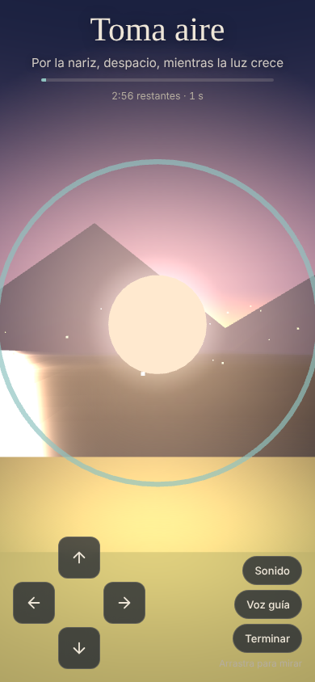

# Respira Lago

Ejercicio de respiración guiada en 3D para ayudar a manejar la **ira**. La persona entra a un lago al atardecer y sigue una luz que crece cuando toma aire y se apaga cuando lo suelta. Hay sonido ambiente, voz guía en español y una escala de ira de 0 a 10 antes y después de cada sesión.

Es un **prototipo (MVP)** para mostrarle a un psicólogo y validar la idea. Funciona con un solo enlace en:

| Dispositivo | Cómo se controla |
|---|---|
| Computador | Arrastrar con el mouse para mirar; flechas o W A S D para moverse |
| Celular | Arrastrar con el dedo para mirar; flechas en pantalla para moverse |
| Gafas de realidad virtual (Meta Quest y otras con WebXR) | Botón **Ver en gafas (VR)**; se mira girando la cabeza |
| Realidad aumentada (Chrome en Android, gafas con passthrough) | Botón **Realidad aumentada**; la luz flota en el cuarto real |

<p align="center">
  
  &nbsp;
  
</p>

> **Aviso:** esto es una herramienta de apoyo, no un tratamiento. No reemplaza la atención de un profesional de salud mental. El contenido terapéutico (tiempos, frases) debe definirlo y validarlo el psicólogo a cargo.

---

## Cómo funciona una sesión

1. **Antes:** la persona marca cuánta ira siente (0 = nada, 10 = máxima) y elige la duración: 1, 3 o 5 minutos.
2. **Respiración:** cada ciclo es *toma aire (4 s) → sostén (1 s) → suelta (6 s) → descansa (1 s)*, unas 5 respiraciones por minuto. La luz, el sonido y la voz siguen el ritmo. La exhalación es más larga que la inhalación porque eso ayuda a bajar la activación del cuerpo.
3. **Después:** vuelve a marcar su nivel de ira y ve la diferencia, por ejemplo **6 → 3**.
4. **Historial:** se guardan las últimas sesiones (fecha, duración, antes y después) **solo en ese navegador**.

Al terminar puede repetir o quedarse caminando libremente por la orilla.

## Probarlo en tu computador

No necesita instalación ni compilación; son archivos estáticos.

```bash
git clone https://github.com/Davidcasstella/respira-lago.git
cd respira-lago
python3 -m http.server 8000
```

Abre `http://localhost:8000`. También funciona abriendo `index.html` con doble clic, aunque es mejor con un servidor local.

Para probar en el celular dentro de la misma red Wi‑Fi, abre `http://IP-DE-TU-PC:8000`. Ten en cuenta que **VR y AR exigen https**, así que para las gafas usa la versión publicada (siguiente sección).

## Publicarlo gratis (GitHub Pages)

1. En el repositorio ve a **Settings → Pages**.
2. En *Source* elige **Deploy from a branch**, rama `progra-2` (la rama de este repo), carpeta `/ (root)`, y guarda.
3. En uno o dos minutos queda en `https://davidcasstella.github.io/respira-lago/`.

Ese enlace ya es https, así que en unas gafas Meta Quest basta con abrirlo en su navegador y tocar **Ver en gafas (VR)**.

> Este repositorio es **público**, así que GitHub Pages es gratis. Si algún día lo vuelves privado, necesitarías GitHub Pro, o puedes publicar la carpeta en **Netlify** o **Vercel** (arrastrar y soltar, también gratis).

## Estructura del proyecto

```
respira-lago/
├── index.html          Página: pantallas de inicio, sesión y cierre
├── css/estilos.css     Colores, tipografía y diseño de las pantallas
├── js/protocolo.js     ← Contenido terapéutico: tiempos y frases (lo edita el psicólogo)
├── js/app.js           Escena 3D, controles, sonido, voz, sesión, VR/AR
└── docs/
    ├── PROTOCOLO.md     Guía para ajustar el ejercicio sin saber programar
    ├── VR-AR.md         Qué es XR, VR y AR, y qué dispositivos sirven
    └── ARQUITECTURA.md  Cómo está hecho por dentro, para desarrolladores
```

## Ajustar el ejercicio

Todo lo terapéutico está en un solo archivo, [`js/protocolo.js`](js/protocolo.js): segundos de cada fase, textos en pantalla, frases de la voz y palabras de la escala. Para cambiar el ritmo a 4‑7‑8, por ejemplo, se cambian tres números. La guía paso a paso está en [docs/PROTOCOLO.md](docs/PROTOCOLO.md).

## Tecnología

- **[Three.js](https://threejs.org/) r128**, cargado desde cdnjs: escena 3D y WebXR (VR/AR).
- **Web Audio API:** las olas y el acorde de fondo se sintetizan en el navegador, sin archivos de audio.
- **Web Speech API:** voz guía en español con la voz que tenga instalada el dispositivo.
- **localStorage:** historial local de sesiones.
- Sin frameworks, sin compilación y sin servidor propio.

Todo está en **escala real (metros)**: los ojos a 1,6 m de altura y la luz a 3 m de distancia. Por eso la misma escena funciona en las gafas sin rehacerla. El movimiento es lento a propósito para no causar mareo en VR.

## Privacidad

- El prototipo **no envía datos a ningún servidor**. Las calificaciones de ira quedan en el `localStorage` del navegador de quien lo usa.
- Si en el futuro se guardan datos en la nube para que el psicólogo los vea, se necesita **consentimiento informado** y cumplir la ley de protección de datos (en Colombia, la Ley 1581 de 2012), porque son datos de salud, es decir, datos sensibles.

## Limitaciones conocidas

- La voz depende de las voces instaladas en el dispositivo; en algunos Android o computadores puede sonar en otro acento o no estar disponible.
- **iPhone/iPad:** Safari no soporta WebXR. Funciona en modo navegador (mirar y moverse con el dedo), pero sin VR ni AR.
- Apple Vision Pro tiene soporte WebXR limitado; hay que probarlo en el dispositivo.
- En VR todavía no hay interacción con los mandos: la sesión arranca sola al entrar.
- El historial no se sincroniza entre dispositivos.

## Próximos pasos sugeridos

- [ ] Validar tiempos y frases con el psicólogo (en `js/protocolo.js`).
- [ ] Grabar una voz guía real (mp3) en lugar de la voz sintética.
- [ ] Usar el giroscopio del celular para mirar girando el teléfono.
- [ ] Usar los mandos o las manos en VR para elegir la duración y responder la escala dentro de las gafas.
- [ ] Más escenarios: bosque, playa, lluvia.
- [ ] Ejercicios para estrés, ansiedad y depresión, cada uno con su propio protocolo.
- [ ] Panel para el psicólogo con el historial de sus pacientes, con consentimiento y datos cifrados.
